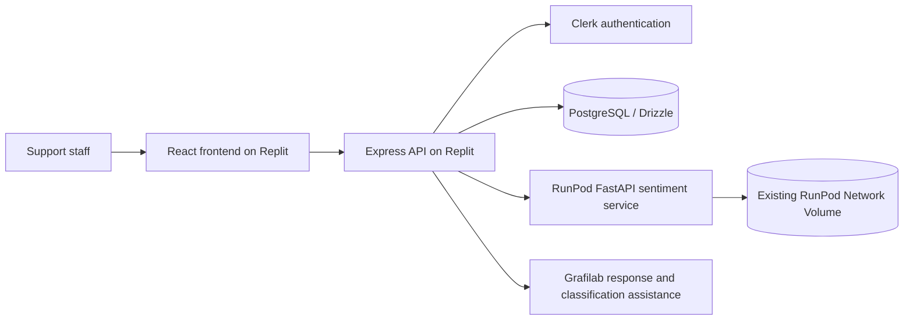

# CoSolve architecture

The RunPod service loads DistilBERT from
`/runpod-volume/artifacts/sentiment-distilbert-v1/model` unless `COSOLVE_MODEL_DIR`
is explicitly overridden. The Replit backend calls it over HTTPS. Service tokens
remain server-side; only Clerk publishable configuration is exposed to the browser.

This submission arrangement preserves application workspace paths and the root
RunPod Docker build. It does not deploy the app, rebuild the GPU image, or change
an endpoint, volume attachment, database, or hosted service.
